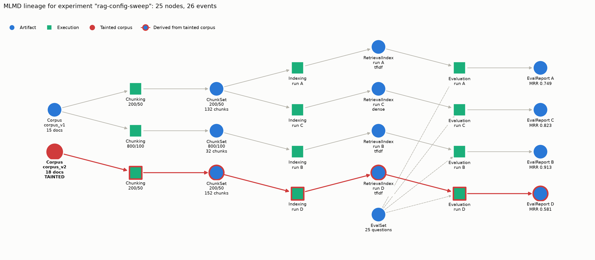

# Why Did the Chatbot Answer Wrong? Tracing RAG Lineage with ML Metadata

A variation of the [ML Metadata Lab 1](https://github.com/raminmohammadi/MLOps/tree/main/Labs/MLMD_Labs/Lab1) (`C2_W3_Lab_1_MLMetadata.ipynb`). The original lab uses [ML Metadata (MLMD)](https://www.tensorflow.org/tfx/guide/mlmd) to record one TFDV schema-inference step. This version uses the same API to track the lineage of a small **retrieval (RAG) pipeline**, then uses that lineage to debug a bad run.

## Concept

The scenario is a support chatbot for **Nimbus Bikes**, a made-up bike company. It answers customer questions by retrieving a chunk from the help-center docs. If retrieval returns the wrong chunk, the answer is wrong no matter which LLM sits on top, so this lab evaluates the retriever only (no LLM, no API keys).

Four pipeline configurations are run, and every step is recorded in a persistent MLMD store. One configuration performs much worse than the others. Using **only the metadata store**, the notebook:

1. finds the worst run from its eval report,
2. walks the lineage **backward** to the exact corpus version and chunking config that produced it,
3. walks **forward** from the suspect corpus to everything derived from it (what needs to be retired), and
4. connects the bad metric to an actual wrong retrieval.

Each pipeline step is an MLMD execution:

```
Corpus --> [Chunking] --> ChunkSet --> [Indexing] --> RetrievalIndex --+
                                                                       +--> [Evaluation] --> EvalReport
                                                              EvalSet --+
```

## Repository layout

```
RAG_Lineage_MLMD.ipynb        # this lab (executed, with outputs)
C2_W3_Lab_1_MLMetadata.ipynb  # original lab, unchanged, for reference
img/mlmd_overview.png         # MLMD data model figure from the original lab
data/
  corpus_v1/                  # 15 help-center docs (150-400 words each)
  corpus_v2/                  # corpus_v1 + 3 tainted docs
  eval/questions.json         # 25 questions with gold doc id and expected answer
assets/lineage_graph.png      # lineage graph produced by the notebook
requirements.txt
metadata/rag_lineage.db       # SQLite MLMD store (generated, git-ignored)
artifacts/                    # chunk sets, indexes, eval reports (generated, git-ignored)
```

## Setup

`ml-metadata` 1.21.0 (latest release) only ships wheels for **Linux x86_64 with glibc 2.39 or newer** and **macOS arm64**, for Python 3.10 to 3.13. It does not install on native Windows. On Windows, use WSL2 with Ubuntu 24.04 (Ubuntu 22.04's glibc is too old).

```bash
# Windows only, in PowerShell:
wsl --install -d Ubuntu-24.04

# Inside Ubuntu 24.04 (or any supported Linux / macOS arm64 machine):
sudo apt update && sudo apt install -y python3.12-venv
python3 -m venv ~/venvs/rag-mlmd          # keep the venv on the Linux filesystem, not /mnt/c
source ~/venvs/rag-mlmd/bin/activate
cd /mnt/c/path/to/MLOps_Lab4              # or wherever you cloned the repo
pip install -r requirements.txt
```

`requirements.txt` pins every direct dependency and pulls the CPU-only PyTorch build, so no CUDA libraries are installed.

## How to run

Interactively:

```bash
jupyter lab                               # open RAG_Lineage_MLMD.ipynb and Run All
```

In VS Code, open the folder through the WSL extension and pick `~/venvs/rag-mlmd/bin/python` as the kernel.

Headless, top to bottom:

```bash
jupyter nbconvert --to notebook --execute --inplace RAG_Lineage_MLMD.ipynb
```

Notes:

* The **Paths and a fresh start** cell deletes `metadata/rag_lineage.db` and `artifacts/` so every Run All starts clean. Set `FRESH_RUN = False` to keep an existing store.
* Run C downloads `sentence-transformers/all-MiniLM-L6-v2` (about 90 MB) from Hugging Face the first time. No token is needed. If the package or the download is unavailable, run C is skipped and the rest of the notebook still runs.
* A full run takes about 20 seconds on a laptop CPU.

## The experiment

| Run | Corpus | Chunk size / overlap (chars) | Retriever | hit@1 | hit@3 | MRR |
|---|---|---|---|---|---|---|
| B | `corpus_v1` | 800 / 100 | TF-IDF (1-2 grams) | 0.84 | 1.00 | 0.913 |
| C | `corpus_v1` | 200 / 50 | MiniLM (`all-MiniLM-L6-v2`) | 0.72 | 0.92 | 0.823 |
| A | `corpus_v1` | 200 / 50 | TF-IDF (1-2 grams) | 0.60 | 0.88 | 0.749 |
| **D** | **`corpus_v2`** | 200 / 50 | TF-IDF (1-2 grams) | **0.36** | 0.84 | **0.581** |

A retrieved chunk counts as **correct** only if it comes from the question's gold document **and** contains the expected answer string, because that is the chunk an LLM would need. A question **fails** when the top-1 chunk is not correct.

`corpus_v2` is a copy of `corpus_v1` plus three outdated pages that conflict with the current ones. They are written like FAQ pages, so their wording is close to the questions customers ask and they get retrieved first:

| Tainted doc | Conflicts with | Example of a wrong fact |
|---|---|---|
| `warranty_faq_2019.md` | `warranty_policy.md` | battery warranty "2 years or 500 full charge cycles" (current: 3 years or 800) |
| `returns_faq_2020.md` | `returns_and_refunds.md` | 14-day return window (current: 30 days) |
| `service_menu_2021.md` | `repair_pricing.md` | basic tune-up $59 (current: $79) |

## MLMD types

| Kind | Name | Properties |
|---|---|---|
| ArtifactType | `Corpus` | `version`, `num_docs` (+ custom `content_sha256`) |
| ArtifactType | `ChunkSet` | `chunk_size`, `overlap`, `num_chunks` |
| ArtifactType | `RetrievalIndex` | `retriever`, `embedding_model` |
| ArtifactType | `EvalSet` | `num_questions` |
| ArtifactType | `EvalReport` | `hit_at_1`, `hit_at_3`, `mrr` (+ custom `run_name`, `num_failed`, `failed_question_ids`) |
| ExecutionType | `Chunking` | `state`, `config`, `chunk_size`, `overlap` |
| ExecutionType | `Indexing` | `state`, `config`, `run_name`, `retriever` |
| ExecutionType | `Evaluation` | `state`, `config`, `run_name` |
| ContextType | `Experiment` | `note`; one context, `rag-config-sweep` |

Every artifact is attached to the context with an **Attribution** and every execution with an **Association**. Each step records `INPUT` and `OUTPUT` **events** with a path key (`corpus`, `chunks`, `index`, `eval_set`, `report`), which is what makes the lineage traversable. Runs A and C share one `ChunkSet`: `run_pipeline` reuses a ChunkSet whose corpus, size and overlap match one already in the store.

## What each lineage query demonstrates

Before the queries, the notebook closes the writer connection and reopens `metadata/rag_lineage.db` read-only. Every query uses only the store, not the Python objects from the runs.

**1. Leaderboard.** Collects every `EvalReport` attributed to the `rag-config-sweep` context and sorts them by MRR in a pandas table. This shows *which* run is bad (D), but the report alone does not say *why*.

**2. `trace_back(artifact_id)`.** Starting at the worst report, follows its `OUTPUT` event to the producing execution, that execution's `INPUT` events to the artifacts it consumed, and recurses down to the raw inputs, printing every node's properties. The notebook then flattens each run's lineage into a table and finds the run closest to the worst one. Run D differs from run A only in `Corpus.version` (v1 -> v2) and the corpus content hash, so the corpus is the prime suspect. Output for the worst run:

```
EvalReport #14 "report__D"  failed_question_ids=q01,q02,q03,q04,q05,q06,q07,q08,q09,q10,q12,q13,q17,q19,q20,q25  hit_at_1=0.360  hit_at_3=0.840  mrr=0.581  num_failed=16  run_name=D
    uri: artifacts/reports/D.json
  <- produced by Evaluation #11 "evaluation__D"  config={"top_k": 3, "correct_if": "gold doc AND contains expected answer", "fail_if": "top-1 chunk not correct"}  run_name=D  state=COMPLETED
    [index] RetrievalIndex #13 "index__D"  embedding_model=tfidf-1-2gram  retriever=tfidf
        uri: artifacts/indexes/D
      <- produced by Indexing #10 "indexing__D"  config={"retriever": "tfidf"}  retriever=tfidf  run_name=D  state=COMPLETED
        [chunks] ChunkSet #12 "chunks__corpus_v2__200_50"  chunk_size=200  num_chunks=152  overlap=50
            uri: artifacts/chunksets/chunks__corpus_v2__200_50.jsonl
          <- produced by Chunking #9 "chunking__chunks__corpus_v2__200_50"  chunk_size=200  config={"chunk_size": 200, "overlap": 50, "unit": "characters, word-aligned"}  overlap=50  state=COMPLETED
            [corpus] Corpus #2 "corpus_v2"  content_sha256=33540eddc0e5  num_docs=18  version=v2
                uri: data/corpus_v2
    [eval_set] EvalSet #3 "nimbus_eval_questions"  num_questions=25
        uri: data/eval/questions.json
```

**3. `trace_forward(artifact_id)`.** The mirror image: from `corpus_v2`, follows `INPUT` events to the executions that consumed it and their `OUTPUT` events to what they produced. It answers "what do we need to retire?": the v2 `ChunkSet`, `RetrievalIndex` and `EvalReport` for run D. For contrast, `corpus_v1` has 8 derived artifacts across runs A, B and C.

**4. From the metric to a wrong retrieval.** Follows the worst report's `uri` to its per-question results and picks a question that failed in D but passed in A. For q02 (*"How many charge cycles does the e-bike battery warranty cover?"*), run D's top chunk comes from `warranty_faq_2019` and says "2 years or 500 full charge cycles", while run A retrieves the current policy chunk with "800 full charge cycles". Comparing the two runs' `Corpus` artifacts shows the retrieved doc exists only in `corpus_v2`. Across all 16 failures in run D, 11 retrieved a tainted doc first.

## Lineage graph

Drawn from the store with networkx and matplotlib. Blue circles are artifacts, green squares are executions, and edges are events. The tainted corpus is red, and everything derived from it has a red outline and red edges. The dashed edges are the shared `EvalSet`.



## Changes from the original lab

* **RAG pipeline instead of TFDV data validation.** Chunking, TF-IDF / MiniLM indexing and retrieval evaluation replace TFDV schema inference on the Chicago Taxi data. TensorFlow and TFDV are no longer needed.
* **Custom types and properties.** Five artifact types (`Corpus`, `ChunkSet`, `RetrievalIndex`, `EvalSet`, `EvalReport`) and three execution types (`Chunking`, `Indexing`, `Evaluation`). Executions store their config as JSON plus a `state`. Custom properties hold extras such as the corpus content hash and failed question ids.
* **Persistent SQLite store.** `metadata/rag_lineage.db` replaces the in-memory fake database. A fresh-run cell deletes it, and the queries run against a read-only reconnection.
* **Multi-config experiment.** A reusable `run_pipeline(config)` runs four configurations under one `Experiment` context, attaches everything through Attributions and Associations, and reuses identical ChunkSets.
* **`INPUT` / `OUTPUT` events** (as recorded by TFX) with path keys, instead of `DECLARED_INPUT` / `DECLARED_OUTPUT`.
* **Tainted-corpus scenario.** A deliberately contaminated corpus version gives the lineage queries a real bug to find.
* **Backward and forward trace functions.** The original lab traced one hop by hand. `trace_back` and `trace_forward` walk the whole graph recursively, and a lineage diff isolates the cause.
* **Graph visualization.** The full lineage graph is drawn from the store, with the tainted corpus and its downstream artifacts highlighted.
* **Own data.** A fictional knowledge base and eval set written for this lab replace the downloaded Chicago Taxi CSVs.
